<p align="center">
  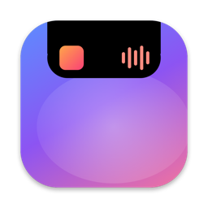
</p>

<h1 align="center">Dynamic Island for Mac</h1>

<p align="center">
  A native Dynamic Island that grows out of your MacBook's notch.<br>
  Now Playing from any app, sound, brightness and Apple Home, animated with real SwiftUI springs.
</p>

<p align="center">
  
  
  
  <a href="../LICENSE"></a>
</p>

<p align="center">
  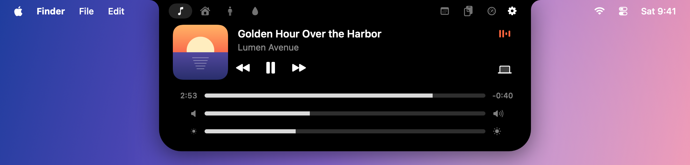
</p>

## Highlights

- **Now Playing from any app.** Music, Spotify, Podcasts, Safari, Chrome and anything else that reports to Control Center. Artwork, title, artist, scrubbing, play/pause and skip.
- **Live activities.** While music plays, the artwork and an equalizer tinted by the album art sit on either side of the notch. A new song gets a short peek.
- **Sound and display.** Volume, mute, brightness and a one-click audio output switcher for speakers, AirPods and AirPlay, like Control Center.
- **HUDs in the notch.** Volume, brightness and output changes appear in the island. It can also replace the system's volume and brightness overlay.
- **Apple Home and Shortcuts.** Pick any shortcut, like a Home scene, and run it with one click from a tile.
- **Calendar.** Your next events, Google Calendar included, with a reminder in the notch 15 minutes before each one and a Join button for Meet, Zoom and Teams links.
- **Clipboard history.** The last 20 things you copied, text and images. Click one to paste it again.
- **Posture companion.** With the [Posture](../Hallning) app running, the island shows your posture and nudges you when you slouch.
- **Feels like a Mac.** Spring animations, blur-and-scale transitions, rubber-band sliders, SF Symbols and trackpad haptics. It never steals focus from the app you're using.

## Gallery

| | |
|:---:|:---:|
| 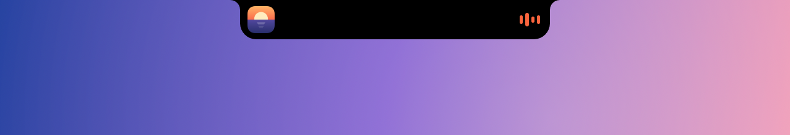<br>**Live activity** while music plays | 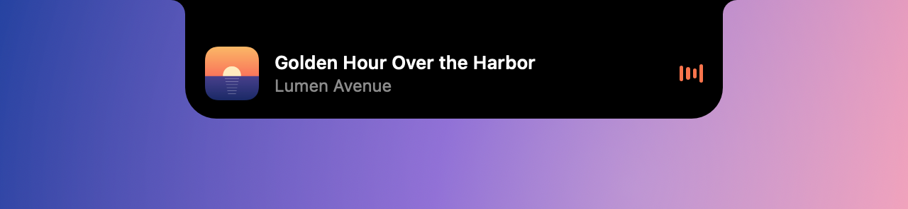<br>**Track change** peek |
| 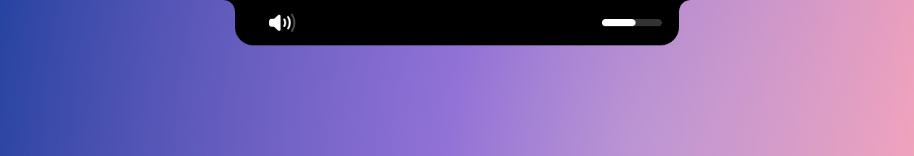<br>**Volume** HUD in the notch | 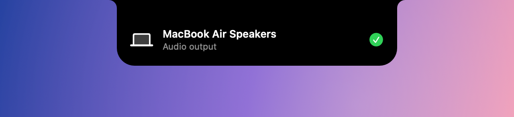<br>**Audio output** changed |
| 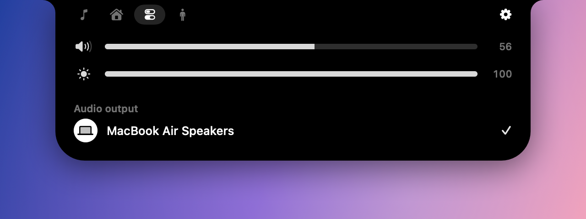<br>**Sound and display** controls | 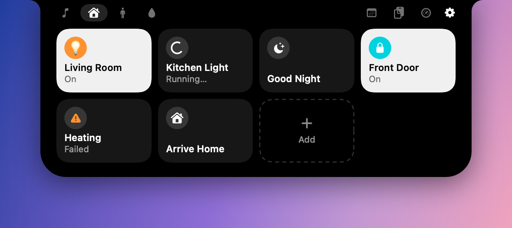<br>**Home** scenes and accessories |
| 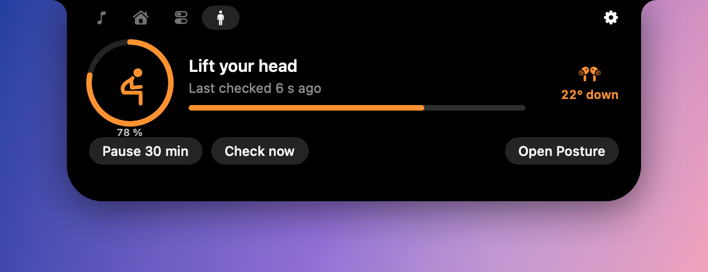<br>**Posture** tab | 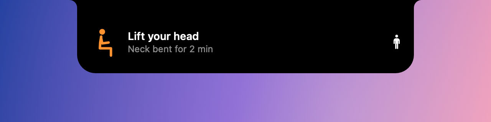<br>**Posture** reminder |

## Requirements

- A Mac with Apple silicon. It's designed for MacBooks with a notch. Other displays get a virtual notch at the top center (untested).
- macOS 14 Sonoma or later. Developed and tested on macOS 26 Tahoe.

## Install

Paste this in Terminal:

```bash
curl -fsSL https://raw.githubusercontent.com/Emsurenar/mac-appar/main/DynamicIsland/install.sh | bash
```

It downloads the latest release into `/Applications` and opens it. Run it again to update. To remove the app and its settings, add `-s -- --uninstall` after `bash`.

<details>
<summary>Download the zip yourself instead</summary>

Get `DynamicIsland.zip` from the [latest release](https://github.com/Emsurenar/mac-appar/releases?q=island-v), unzip it and drag **Dynamic Island** to Applications. The app isn't notarized by Apple, so the first time macOS says it can't check it for malware. Open **System Settings › Privacy & Security**, scroll down and click **Open Anyway**. The install script above skips this step, because macOS only checks apps downloaded by a browser.
</details>

<details>
<summary>Build it from source</summary>

You need Xcode 16 or later, or just the Command Line Tools (`xcode-select --install`).

```bash
git clone https://github.com/Emsurenar/mac-appar.git
cd mac-appar/DynamicIsland
./build.sh --run
```

This builds `build/Dynamic Island.app` and launches it. The script signs the app with the first code-signing identity in your keychain, or ad hoc if there is none. A stable identity keeps the Accessibility permission across rebuilds. Choose one with `SIGN_IDENTITY="Your Identity" ./build.sh`.
</details>

## First launch

A welcome window explains where the island is and sets up the basics in one place:

- **Move to Applications**, if the app runs from somewhere else, like Downloads.
- **Launch at login** and whether the island opens on hover.
- **Optional permissions**, each asked for only when you turn its feature on: Calendars for upcoming events, Accessibility for showing volume and brightness in the notch.
- **Home scenes**, which jumps straight to picking shortcuts.

Click **Show me the island** and it opens once, so you see where it lives. You can show the welcome again under **Settings › About**.

## Using it

- **Hover** over the notch to open the island. Move the pointer away to close it. If you prefer clicking, turn off hover in settings.
- **Tabs** in the top-left corner switch between Now Playing, Home, Sound and display, and Posture.
- **Click the artwork** to bring the playing app to the front. Click the output icon to jump to the output picker.
- **Right-click** the island, or use the gear, for **Settings** and **Quit**. The app has no Dock icon.

### Apple Home and Shortcuts

Native Mac apps can't use HomeKit. It's only available to Mac Catalyst apps with a paid developer entitlement. So the island runs your **Shortcuts** instead. They can be Home scenes that use the **Control Home** action, or anything else:

1. Open the **Home** tab and click **Choose Shortcuts**, or the **+** tile once you have tiles.
2. Tick the shortcuts you want. Each one becomes a tile, and clicking a tile runs its shortcut.
3. A leading emoji becomes the tile's icon. Otherwise an SF Symbol is picked from the name: light, lamp, lock, door, heat, fan, blinds, TV, night, morning and more, in English or Swedish.
4. To make a tile show **On/Off**, end the shortcut by outputting the text `on` or `off`.

Right-click a tile to give it its own color from the color wheel, to remove it, or to edit it in Shortcuts. The colors can also be set under **Tile Colors** in settings. Shortcuts in a folder named **Home** also get a tile automatically. You can change or clear that folder name in settings.

| | |
|:---:|:---:|
| 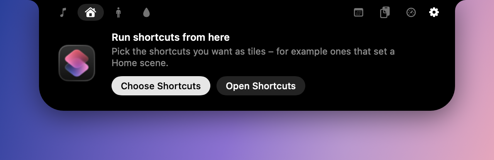<br>Before you pick any | 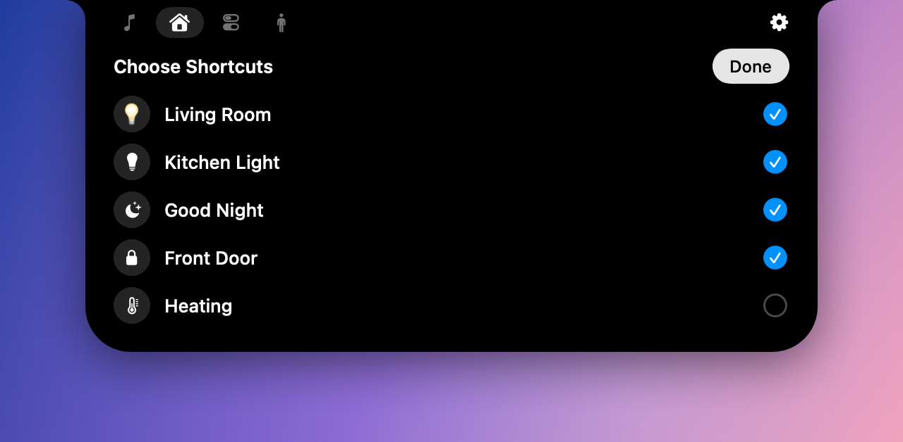<br>Choosing shortcuts |

### Replacing the system volume HUD

Turn on **Replace the system volume and brightness HUD** in settings and grant **Accessibility** access when asked. The volume and brightness keys then show only in the island. Hold <kbd>⌥</kbd><kbd>⇧</kbd> for quarter steps, like on macOS.

### Posture

[Posture](../Hallning) is a companion menu bar app in this repository. While it runs, the island gets a Posture tab with today's score, the neck angle from AirPods, and buttons to pause or check now. When you've slouched for a while, a reminder appears in the notch instead of as a notification.

### Calendar

The island reads events from the macOS **Calendar** app, so any account added there works, including Google. To add Google, open **System Settings › Internet Accounts**, add your Google account and turn on **Calendars**. Then open the calendar tab in the island and click **Allow Access**.

The tab lists the rest of today's events, or tomorrow's once the day is done. A few minutes before an event starts, a reminder drops out of the notch. Choose how early, from 1 to 30 minutes, under **Calendar** in settings. Click the reminder to open the calendar tab, or **Join** to open a Meet, Zoom or Teams link.

### Clipboard

The clipboard tab keeps the last 20 things you copied, newest first, with the app each came from. Click an item to put it back on the clipboard and paste it into the app you're in. Pasting sends ⌘V, so it needs Accessibility access; without it, or with **Paste the item you pick** turned off, the item is only copied. Hover over an item to remove it, or use **Clear**.

The history lives in memory only and is gone when the app quits. Passwords copied from password managers that mark them as concealed, like 1Password, are never kept.

## Permissions and privacy

| Permission | Used for | Required |
|---|---|:---:|
| Accessibility | Replacing the system volume and brightness HUD, pasting from the clipboard history | Optional |
| Calendars | The Calendar tab and event reminders | Optional |

Everything else, like Now Playing, volume, outputs and brightness, works without any prompts. Shortcuts may ask for access to Home the first time a Home shortcut runs.

The app has no network code, analytics or accounts. Everything stays on your Mac.

## How it works

<details>
<summary><b>The notch window</b></summary>

The island is a borderless, transparent `NSPanel` placed above the menu bar on every Space, including over full-screen apps. It's non-activating, so it never takes focus. `NSScreen.auxiliaryTopLeftArea` and `auxiliaryTopRightArea` give the exact notch rectangle, and a black shape of that size sits over the hardware cutout, where it's invisible. When the shape grows, it looks like the notch itself expands.

The panel is much larger than the island, so it lets clicks through (`ignoresMouseEvents`) unless the pointer is inside the island's hover zone. A global mouse monitor follows the pointer. Watching mouse movement needs no permission. Short delays (90 ms to open, 220 ms to close) keep it from flickering when the pointer brushes past.
</details>

<details>
<summary><b>Shape and motion</b></summary>

`NotchShape` is an animatable SwiftUI `Shape` with concave "ears" where it meets the top of the screen and rounded bottom corners. Both radii animate together with the size, so the outline morphs between states instead of cross-fading. Every state has its own spring: a slight bounce when opening and a calm, critically damped close. Content enters with a blur and scale from the notch, and the artwork moves between states with `matchedGeometryEffect`.

`IslandPresentation(_:)` decides what the island shows by picking the most important state: open, HUD, calendar reminder, posture reminder, track peek, music live activity, posture live activity, and finally closed. `IslandGeometry` turns that into a size, corner radii and the hover zone. Both are plain values, so the tests cover them without any windows or services.
</details>

<details>
<summary><b>Now Playing</b></summary>

The system-wide Now Playing state lives in Apple's private **MediaRemote** framework. Since macOS 15.4, MediaRemote only answers processes signed by Apple. To get around that, `Bridge/NowPlayingBridge.m` is compiled into a small dynamic library that is loaded into `/usr/bin/perl`, an Apple-signed binary, through Perl's `DynaLoader`. The bridge talks to the app over stdio. It writes one JSON line per change (artwork as base64, only when it changes) and reads commands like `toggle`, `next` and `seek 42.5`. It exits when the app quits.

This technique was pioneered by [ungive/mediaremote-adapter](https://github.com/ungive/mediaremote-adapter).
</details>

<details>
<summary><b>Sound, brightness and keys</b></summary>

- **Core Audio** provides output devices, volume and mute as properties. The app subscribes to them with property listeners, so external changes, like the keyboard, show up instantly without polling. Switching outputs sets the system's default output device.
- **Brightness** uses the private `DisplayServices` framework to read and set the built-in display's brightness.
- **Replacing the HUD** uses a `CGEventTap` for `NX_SYSDEFINED` media-key events. The tap handles volume and brightness keys itself and swallows them before the system shows its overlay.
- **Haptics** use `NSHapticFeedbackManager`. They fire on the pointer movement that reaches the notch, and when a slider hits its end, because the trackpad only plays them while a finger is on it.
</details>

<details>
<summary><b>Home and Posture</b></summary>

- **Home** shells out to `/usr/bin/shortcuts`. It lists all your shortcuts (and those in the optional folder), remembers the ones you picked by identifier, and runs one with `--output-path`, so the shortcut's output can set the tile's on/off state.
- **Posture** talks to the companion app over `DistributedNotificationCenter`. Posture broadcasts its state and reminders. The island says hello, so Posture shows reminders in the notch instead of as notifications, and sends button presses back as commands.
</details>

## Project structure

```
DynamicIsland/
├── build.sh                    # Builds, bundles and signs the .app
├── install.sh                  # Installs the latest release
├── Package.swift
├── Bridge/NowPlayingBridge.m   # MediaRemote bridge, runs inside /usr/bin/perl
├── Resources/                  # Info.plist, app icon
├── Scripts/make-icon.swift     # Draws AppIcon.icns
└── Sources/DynamicIsland/
    ├── App/                    # Entry point and app delegate
    ├── Island/                 # Window, presentation and geometry, state model
    ├── Services/               # Now Playing, audio, brightness, keys, Home, Posture
    ├── Settings/               # Preferences and settings window
    ├── Welcome/                # First-launch window, moving to Applications, login item
    ├── Views/                  # Island shape, live activities, tabs, components
    └── Debug/                  # Snapshot renderer (debug builds only)
Tests/DynamicIslandTests/       # Unit tests: presentation, geometry, Home, settings
```

## Development

```bash
CONFIG=debug ./build.sh            # debug build
swift test                         # unit tests (needs Xcode)
"build/Dynamic Island.app/Contents/MacOS/DynamicIsland" --snapshots /tmp/island   # render every state to PNG
"build/Dynamic Island.app/Contents/MacOS/DynamicIsland" --trace    # log every state change
swift Scripts/make-icon.swift .    # redraw the app icon
```

The screenshots in this README come from `--snapshots`.

To publish a release, push a tag like `island-v1.1.0`. The **Dynamic Island release** workflow builds the app and attaches `DynamicIsland.zip` to a GitHub release, which `install.sh` picks up.

## Troubleshooting

- **Nothing appears at the top of the screen.** The app has no Dock icon. Point at the notch, or at the top center of the screen on a display without one. Open the app again from Applications to bring up Settings.
- **"Dynamic Island can't be opened" or "Apple could not verify…".** The app isn't notarized. Use **Open Anyway** in **System Settings › Privacy & Security**, or install it with the script above.
- **The volume keys stopped showing in the island after an update.** Releases are signed ad hoc, so macOS sees each version as a new app. Remove Dynamic Island under **System Settings › Privacy & Security › Accessibility** and turn the setting on again.
- **No song shows up.** The app playing must report to Control Center. Check that it shows there.

## Known limitations

- The app uses private frameworks (MediaRemote, DisplayServices), so it can't be sandboxed or ship on the App Store, and a macOS update could break those parts.
- A Home tile's on/off state reflects the last time the island ran that shortcut, not changes made elsewhere.
- Trackpad haptics need a Force Touch trackpad and a finger on it.
- The interface is in English only.

## Acknowledgements

Inspired by the iPhone's Dynamic Island and by Mac notch apps like [NotchNook](https://lo.cafe/notchnook), [Alcove](https://tryalcove.com) and [boring.notch](https://github.com/TheBoredTeam/boring.notch). Thanks to [mediaremote-adapter](https://github.com/ungive/mediaremote-adapter) for showing the way around the MediaRemote restrictions.

## License

[MIT](../LICENSE)

*Not affiliated with Apple. Dynamic Island, Mac and HomeKit are trademarks of Apple Inc.*
