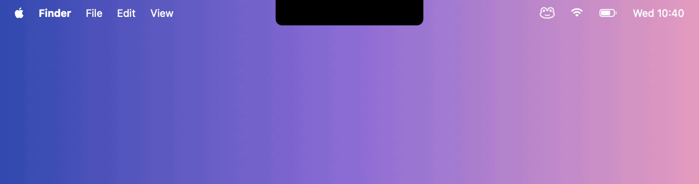

<h1 align="center">mac-appar</h1>

<p align="center">
  Three native macOS apps written in Swift and SwiftUI.<br>
  No Xcode project: each app builds with a one-line script.
</p>

<p align="center">
  <a href="https://github.com/Emsurenar/mac-appar/actions/workflows/build.yml"></a>
  
  
  <a href="LICENSE"></a>
</p>

<p align="center">
  
</p>

## The apps

### [Dynamic Island](DynamicIsland)

A Dynamic Island that grows out of your MacBook's notch. It shows Now Playing from any app with artwork and controls, and lets you set volume, brightness and audio output, including AirPods and AirPlay. It shows volume and output changes as HUDs in the notch, and runs your Apple Home scenes through Shortcuts. The animations use the same springs as the iPhone.

→ [Read more](DynamicIsland/README.md)

### [Posture](Hallning)

A menu bar app that keeps an eye on how you sit. Every 10 seconds it reads your shoulders, head and face from the camera with Apple's Vision framework, and AirPods can add your neck angle. It learns your own good and bad postures from a short calibration and reminds you, with concrete advice, when you've been slouching for a while. With Dynamic Island running, the reminders appear in the notch.

→ [Read more](Hallning/README.md)

<p align="center">
  
</p>

### [Unknot](Unknot)

Stretch breaks that drop out of the camera notch. Every 20 minutes a member of the Stretch Crew, fifteen
characters drawn like small engravings, shows three short exercises in a black island, with Dynamic Island's
look and springs, and goes back into the notch. Breaks wait for a pause in your typing, for calls and for full-screen apps, and time away counts as a
break. It's the one app here with ready-made releases: install it with one line and it updates itself from the
menu bar.

```bash
curl -fsSL https://raw.githubusercontent.com/Emsurenar/mac-appar/main/Unknot/install.sh | bash
```

→ [Read more](Unknot/README.md) · [Website](https://emsurenar.github.io/mac-appar/unknot/) · [Releases](https://github.com/Emsurenar/mac-appar/releases?q=unknot-v&expanded=true)

<p align="center">
  
</p>

## Requirements

| | Dynamic Island | Posture | Unknot |
|---|---|---|---|
| macOS | 14 Sonoma or later | 26 Tahoe or later | 14 Sonoma or later |
| Mac | Apple silicon. Designed for MacBooks with a notch | Apple silicon with a camera | Apple silicon or Intel, notch optional |
| Tools | Xcode 16+ or the Command Line Tools | Xcode 26+ or the Command Line Tools | The Command Line Tools |

## Build and run

```bash
git clone https://github.com/Emsurenar/mac-appar.git
cd mac-appar

# Dynamic Island
DynamicIsland/build.sh --run

# Posture
Hallning/build.sh --run

# Unknot
Unknot/build.sh && open Unknot/build/Unknot.app
```

Dynamic Island and Posture are Swift packages: their scripts build a release binary with Swift Package Manager, wrap it in an `.app` bundle in the app's `build/` folder, sign it and, with `--run`, launch it. Unknot's script compiles its sources with `swiftc`, draws its icon and runs its self-test; `--release` makes a universal app and `dist/Unknot.zip`. All three live in the menu bar and have no Dock icon.

## How Dynamic Island and Posture work together

The apps are independent, and each one works on its own. When both run, they talk over `DistributedNotificationCenter`:

- Posture broadcasts its state after every check, and its reminders.
- Dynamic Island announces itself. Posture then sends reminders to the notch instead of as notifications, and the island sends button presses (pause, check now) back.

## Repository layout

```
mac-appar/
├── DynamicIsland/   # The notch app (Swift package, build script, screenshots)
├── Hallning/        # The Posture app (Swift package, build script)
├── Unknot/          # Stretch breaks (build script, install script, website in docs/)
└── .github/         # CI for each app, Unknot's releases and website, issue forms
```

## Contributing

Issues and pull requests are welcome. Please keep changes in the style of the surrounding code and make sure the apps still build:

```bash
(cd DynamicIsland && swift build) && (cd Hallning && swift build) && Unknot/build.sh
```

Unknot has its own [contributing guide](Unknot/CONTRIBUTING.md), with tools for checking its drawings and animations and its release steps.

## License

[MIT](LICENSE) © 2026 Emre Sunar

*Not affiliated with Apple. Dynamic Island, Mac and AirPods are trademarks of Apple Inc.*
